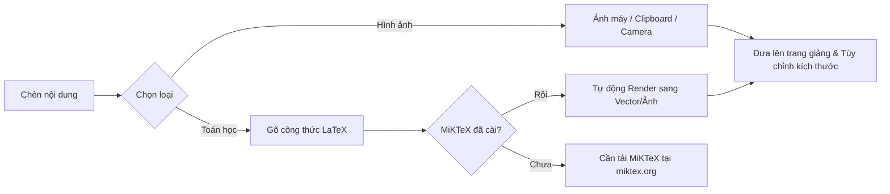

# 🖊️ OmniPen 1.5 – Viết Bảng Điện Tử & Chú Thích Màn Hình


> 💡 **OmniPen** là phần mềm viết bảng điện tử miễn phí dành cho giáo viên: viết, vẽ, chú thích trực tiếp lên màn hình; biến máy tính thành bảng đen – bảng trắng nhiều trang; ghi chú lên PDF; chèn hình, ảnh, công thức toán và xuất bài giảng ra PDF/PNG/SVG.

---

## 👨‍🏫 1. THÔNG TIN TÁC GIẢ & CÀI ĐẶT

### 👤 Tác giả & Quyên góp
* **Tác giả:** Hồ Văn Thuyên – Trường THPT Hoàng Hoa Thám
* **Ủng hộ tác giả:** [www.giaoducso.org](http://www.giaoducso.org)
* **Yêu cầu hệ thống:** Windows 10 (1809 trở lên) / Windows 11, 64-bit hoặc 32-bit. *Không cần cài .NET.*

---

## 🚀 Hướng Dẫn Cài Đặt

| Loại Bản Cài | File Thực Thi | Hướng Dẫn |
| --- | --- | --- |
| **Bản Cài Đặt (Setup)** | `OmniPen_Setup_v1.5.exe` | Chạy file `.exe` $\rightarrow$ Chọn *Tiếp* $\rightarrow$ *Cài đặt*. Tự động liên kết file `.omnipen`. Không cần quyền Admin. |
| **Bản Di Động (Portable)** | `OmniPen_v1.5_x64_portable.exe` | Tải về, bấm đúp để chạy ngay không cần cài đặt. |

> [!NOTE]
> **Cảnh báo Windows SmartScreen:** Vì phần mềm chưa đăng ký chữ ký số thương mại, Windows có thể hiển thị cảnh báo bảo vệ. Bạn chỉ cần nhấn **"More info"** $\rightarrow$ chọn **"Run anyway"** để khởi chạy.

---

## 🧰 Chi Tiết Thanh Công Cụ & Tính Năng

### 1. Công Cụ Vẽ & Hình Học Cơ Bản

| Biểu Tượng | Công Cụ | Mô Tả Chức Năng |
| --- | --- | --- |
| 🖱️ | **Chuột** | Thao tác bình thường với PowerPoint, trình duyệt... phía dưới mà vẫn giữ nguyên nét vẽ. |
| ⬚ | **Chọn** | Khoanh vùng để di chuyển, đổi cỡ nét hoặc xóa tệp bằng phím `Delete`. |
| ✏️ | **Bút** | Hỗ trợ lực nhấn (Wacom, Surface Pen), nét vẽ tự động làm mượt. |
| 🖍️ | **Dạ quang** | Tô đánh dấu trong suốt, luôn hiển thị phía dưới nét bút. |
| 🧹 | **Tẩy** | Bấm 1 lần để tẩy từng phần; bấm tiếp lần 2 để xóa toàn bộ nét. |
| ╱ | **Hình học** | Đường thẳng, mũi tên, chữ nhật, tròn, tam giác, hình hộp, bảng $N \times M$. Giữ `Shift` để bắt góc $15^\circ$ hoặc vẽ hình đều. |
| 📏 | **Thước kẻ** | Kéo di chuyển, xoay núm xanh để chỉnh góc. Bút vẽ sát mép thước tự nắn thẳng. |
| ⊙ | **Compa** | Đặt tâm và kéo bán kính để vẽ đường tròn/cung tròn cùng tâm. |
| **Aa** | **Chọn chữ** | Tương tác chọn văn bản trên file PDF có lớp chữ (Text Layer). |
| 🎨 | **Màu & Nét** | 4 màu chọn nhanh + Bảng màu mở rộng. Độ dày nét tùy chỉnh từ $1 \to 40$. |

---

### 2. ✨ Mới Trong Bản 1.5 – Trợ Giảng & Trình Chiếu

* 🪄 **Bút laser (`L`):** Nét vẽ phát sáng tự động biến mất sau 3 giây.
* ▬ **Băng che chữ:** Quẹt để che đáp án/văn bản $\to$ Bấm nhẹ vào băng để "bốc hơi" hiện đáp án.
* ◍ **Làm mờ nhạy cảm:** Kéo khung để làm mờ nhanh mật khẩu, thông tin cá nhân trực tiếp trên màn hình.
* 📈 **Vẽ đồ thị Oxy:** Hỗ trợ nhập trực tiếp hàm số (vd: `y = sin(x)`, `y = x^2 - 4x + 3`) dạng vector.
* ✍️ **Tự nắn hình thông minh:** Vẽ tay hình tròn, tam giác, chữ nhật rồi **giữ bút $\sim 1$ giây** ở cuối nét để tự động nắn chuẩn.
* 🧰 **Bộ tiện ích nâng cao:**
* **Chụp màn hình (`Ctrl+Shift+X`):** Lưu nhanh vào thư mục và Clipboard.
* **Hiển thị thao tác:** Hiển thị bong bóng phím tắt & hiệu ứng gợn sóng khi click chuột.
* **Kính lúp động (`Ctrl+Shift+M`):** Phóng to $2\times \to 3\times$ bám theo con trỏ chuột.
* **Dán Code (`Ctrl+Shift+Q`):** Định dạng khối code màu Dracula có sẵn số dòng.
* **Nhận diện chữ viết tay:** Chuyển nét vẽ tay thành văn bản gõ máy.
* **Tiện ích lớp học:** Đồng hồ đếm ngược nổi & Vòng quay gọi tên ngẫu nhiên.


---

## 📋 Chế Độ Bảng & Ghi Chú PDF

### 📄 Chế Độ Bảng Giảng

* **Đa dạng nền bảng:** Giấy trắng, Kẻ ngang, Ô vuông, Ô ly tiểu học (4 ô ly), Bảng trắng, Bảng đen, Bảng xanh *(bút tự chuyển sang nét trắng khi vào bảng tối color)*.
* 🔄 **Chế độ Tự Cuộn (Infinite Canvas):** Viết tới cuối màn hình, trang tự động trôi lên nối dài như một cuộn giấy không giới hạn.
* 🔍 **Thao tác thu phóng:** `Ctrl + Lăn chuột` để phóng to/thu nhỏ quanh con trỏ; dùng công cụ **Bàn tay (✋)** hoặc phím `Shift + Lăn chuột` để di chuyển màn hình.

### 📑 Ghi Chú Trực Tiếp Trên PDF

1. Vào `⋯` $\to$ **"Mở PDF để ghi chú..."**.
2. Từng trang PDF sẽ biến thành một trang bảng cho phép viết, vẽ, chèn nội dung thoải mái.
3. Sử dụng công cụ **Aa** để Sao chép, Tô sáng, Gạch chân hoặc Gạch ngang trực tiếp trên văn bản PDF.
4. *Lưu ý:* Khi lưu file dưới dạng `.omnipen`, toàn bộ dữ liệu PDF gốc và nét vẽ sẽ được đóng gói đi kèm.

---

## 📐 Chèn Công Thức LaTeX & Hình Ảnh



* **Ví dụ gõ LaTeX:** `x = \frac{-b \pm \sqrt{b^2-4ac}}{2a}`

---

## 📤 Định Dạng Xuất File (Export)

* 📄 **PDF:** Xuất toàn bộ trang bảng hoặc các trang đang chú thích thành file PDF hoàn chỉnh.
* 🖼️ **PNG (Có nền):** Lưu ảnh trang hiện tại kèm theo màu nền bảng.
* 🖼️ **PNG (Trong suốt):** Chỉ lưu nét vẽ và ảnh chèn (nền trong suốt), cực kỳ tiện lợi khi dán vào Word/PowerPoint.
* 📐 **SVG (Vector):** Giữ nguyên độ nét, mịn và độ dày lực nhấn bút khi phóng to ở mọi kích thước.

---

## ⌨️ Bảng Phím Tắt Tiện Lợi

### Phím Tắt Toàn Cục (Global Hotkeys)

> *Sử dụng được ngay cả khi phần mềm đang ẩn dưới khay hệ thống. Có thể tùy chỉnh trong `⋯` $\to$ `Cài đặt`.*

| Phím Tắt | Chức Năng | Phím Tắt | Chức Năng |
| --- | --- | --- | --- |
| Ctrl + Shift + D | Bật / Tắt chế độ vẽ | Ctrl + Shift + B | Bật / Tắt bảng |
| Ctrl + Shift + E | Chọn nhanh Tẩy | Ctrl + Shift + H | Hiện / Ẩn thanh công cụ |
| Ctrl + Shift + C | Xóa toàn bộ trang | Ctrl + Shift + M | Kính lúp động ($2\times \to 3\times$) |
| Ctrl + Shift + Q | Dán Code từ Clipboard | Ctrl + Shift + X | Chụp nhanh vùng màn hình |

### Phím Tắt Trong Khi Vẽ

* Esc: Trở về công cụ Chuột / Hủy thao tác vẽ dở.
* P: Bút · H: Dạ quang · L: Bút laser · E: Tẩy · S: Chọn · R: Thước kẻ.
* Delete: Xóa vùng chọn · Ctrl+Z / Ctrl+Y: Hoàn tác / Làm lại.
* PageUp / PageDown: Chuyển nhanh trang bảng.

---

## 🛠️ Hướng Dẫn Build Mã Nguồn (Developer)

### Thư Mục Dự Án & Cấu Trúc

```text
OmniPen/
├── src/OmniPen/             # Mã nguồn C# WPF (.NET 8 Windows SDK)
├── Directory.Packages.props # Quản lý thư viện NuGet tập trung (CPM)
├── installer/                # Kịch bản Inno Setup & ngôn ngữ Tiếng Việt
└── build.bat                 # Script đóng gói tự động

```

### Cách Build Nhanh

Bấm đúp vào file `build.bat`. Kịch bản tự động kiểm tra và cài đặt **.NET 8 SDK** & **Inno Setup 6** (qua `winget` nếu thiếu), sau đó xuất bản đóng gói tại thư mục `dist/`:

* `dist/OmniPen_Setup_v1.5.exe`
* `dist/OmniPen_v1.5_x64_portable.exe`

---

## 💖 Ủng Hộ Tác Giả

Nếu bạn thấy **OmniPen** hữu ích cho việc giảng dạy, hãy ủng hộ tác giả phát triển dự án bằng cách quét mã QR (VietQR / MoMo) 09.6618.7618 `Ủng hộ tác giả**` trong ứng dụng hoặc truy cập website:

👉 **[www.giaoducso.org](http://www.giaoducso.org)**

```

```
